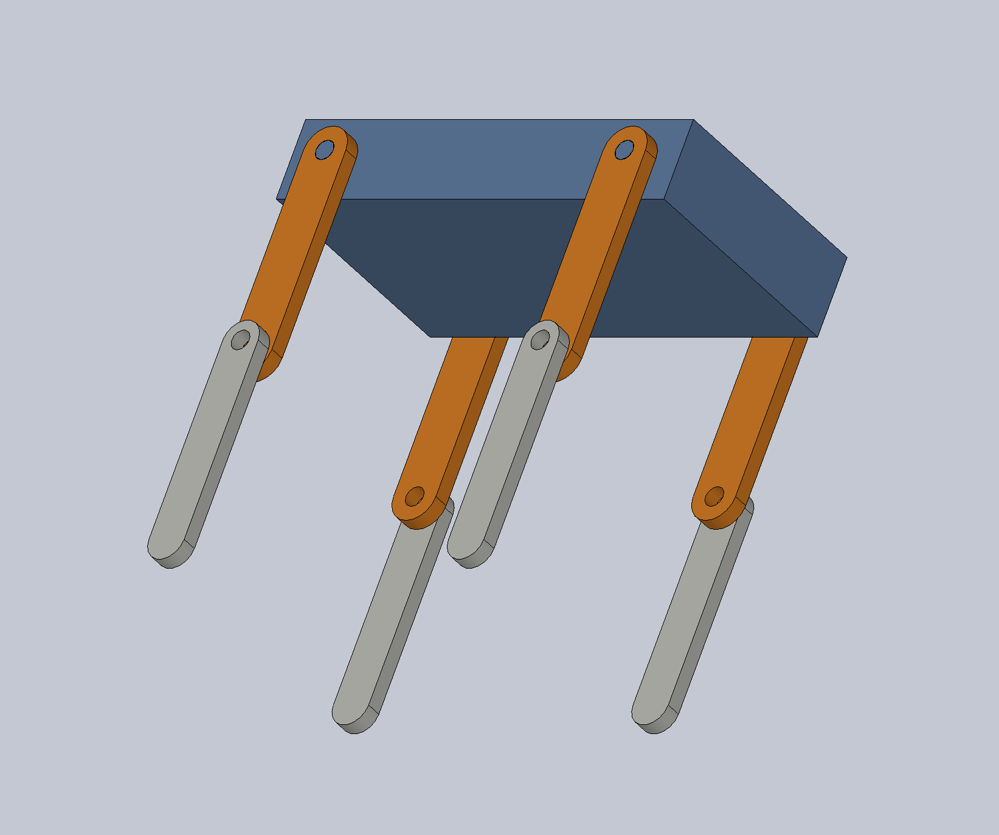
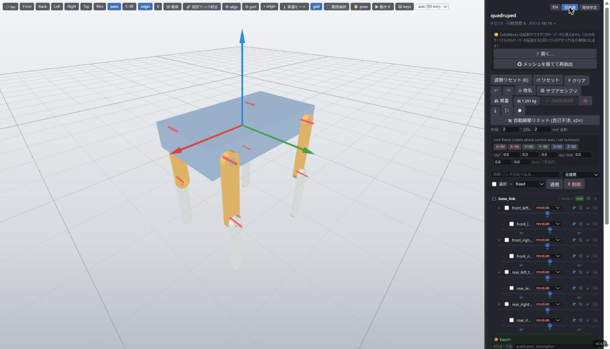

# sw2robot

**SolidWorks のアセンブリ → URDF。** sw2robot はアセンブリの**合致（メイト）**
を読んでリンクの木構造と関節軸を推定します。結果はブラウザのエディタで確認・
修正でき、ROS 2 / MuJoCo / Isaac Sim 向けのパッケージとして書き出せます。

{ width="420" }
{ width="420" }

はじめての方は **[4脚ロボットをゼロから作る →](tutorial.md)** へ。
3 つの簡単な部品から、名前と可動範囲のついた 8 関節の URDF までを通しで
説明します。

## 1 行でインストール {#install}

ビルド済みのエディタは Python 不要です。`sw2robot-web` として `PATH` に
入ります。

=== "Linux / macOS"

    ```bash
    curl -LsSf https://jsk-ros-pkg.github.io/solidworks_urdf_exporter2/install.sh | sh
    ```

=== "Windows (PowerShell)"

    ```powershell
    powershell -ExecutionPolicy ByPass -c "irm https://jsk-ros-pkg.github.io/solidworks_urdf_exporter2/install.ps1 | iex"
    ```

`sw2robot-web` を実行すると、ブラウザで `http://localhost:8090` が開きます。

コマンドラインツール（`sw2urdf`、`python -m sw2robot.exporter.build`）を
使う場合:

```bash
pip install sw2robot
```

!!! note "SolidWorks が必要なのはどこか"
    SolidWorks（と Windows）が必要なのは **抽出**（`.SLDASM` の読み込み）だけ
    です。COM で SolidWorks を動かすためです。編集・ビルド・書き出しは
    Windows / macOS / Linux のどれでも動きます。

## その他

- [README](https://github.com/jsk-ros-pkg/solidworks_urdf_exporter2#readme):
  エディタの全機能とキーボードショートカット、各種エクスポート
- [最新リリース](https://github.com/jsk-ros-pkg/solidworks_urdf_exporter2/releases/latest)
- [Issues](https://github.com/jsk-ros-pkg/solidworks_urdf_exporter2/issues)
