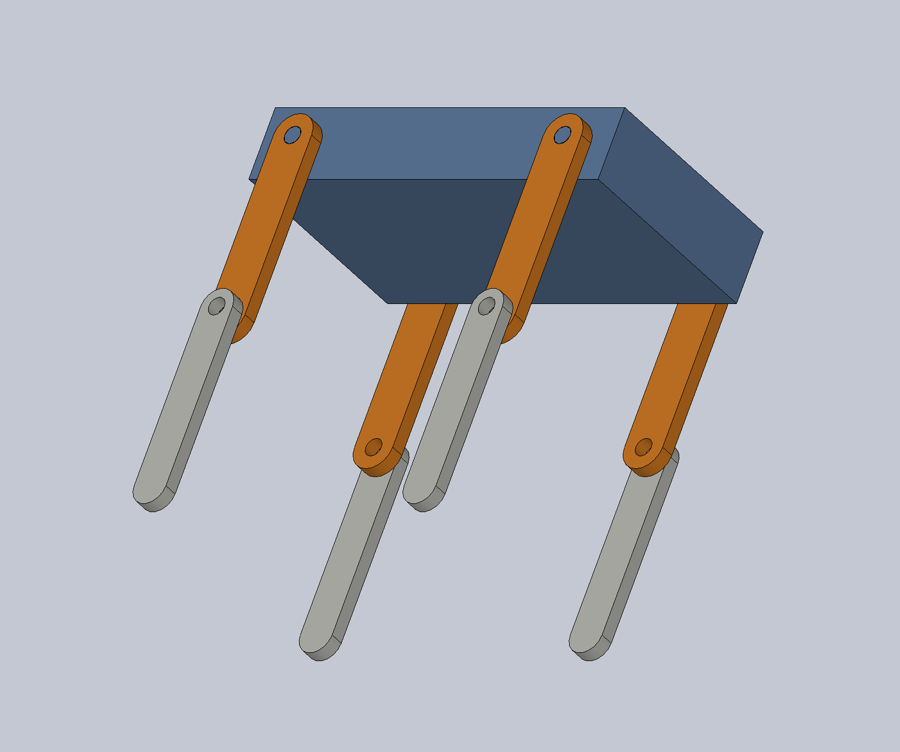
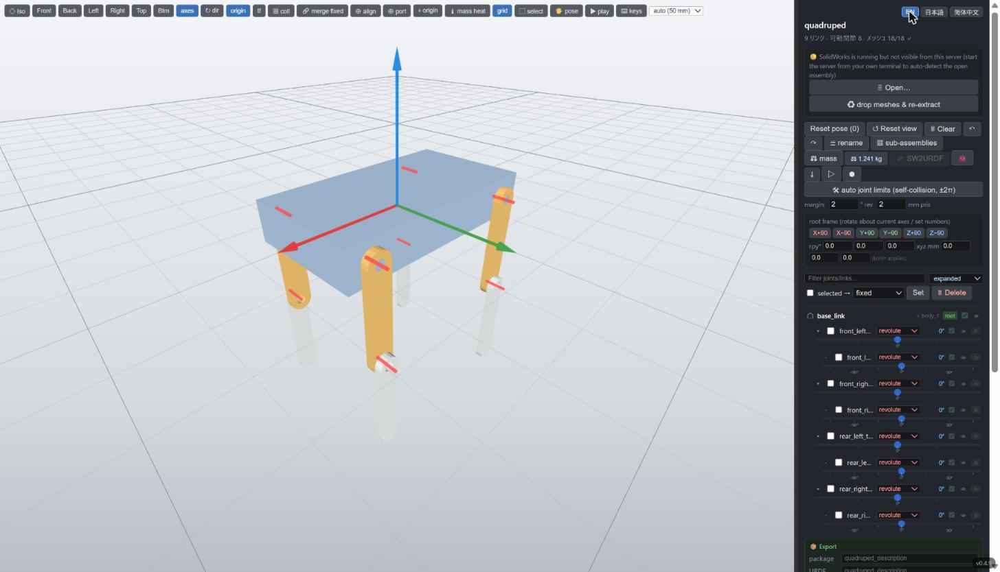

# sw2robot

**SolidWorks assembly → URDF.** sw2robot reads the *mates* of a SolidWorks
assembly to work out the link tree and the joint axes, then lets you check and
clean up the result in a browser editor and export a ROS 2, MuJoCo or Isaac
Sim package.

{ width="420" }
{ width="420" }

New here? **[Build a quadruped from scratch →](tutorial.md)** It takes you
from three simple parts to a named, limited, 8-joint URDF.

## Install in one line {#install}

The prebuilt editor needs no Python. It installs as `sw2robot-web` on your
`PATH`.

=== "Linux / macOS"

    ```bash
    curl -LsSf https://jsk-ros-pkg.github.io/solidworks_urdf_exporter2/install.sh | sh
    ```

=== "Windows (PowerShell)"

    ```powershell
    powershell -ExecutionPolicy ByPass -c "irm https://jsk-ros-pkg.github.io/solidworks_urdf_exporter2/install.ps1 | iex"
    ```

Then run `sw2robot-web`; it opens the editor at `http://localhost:8090`.

For the command-line tools (`sw2urdf`, `python -m sw2robot.exporter.build`):

```bash
pip install sw2robot
```

!!! note "What needs SolidWorks"
    Only **extract** (reading the `.SLDASM`) needs Windows and SolidWorks,
    because it drives SolidWorks over COM. Editing, building and exporting
    run on Windows, macOS and Linux.

## More

- [README](https://github.com/jsk-ros-pkg/solidworks_urdf_exporter2#readme):
  every editor feature and keyboard shortcut, plus the exporters
- [Latest release](https://github.com/jsk-ros-pkg/solidworks_urdf_exporter2/releases/latest)
- [Issues](https://github.com/jsk-ros-pkg/solidworks_urdf_exporter2/issues)
