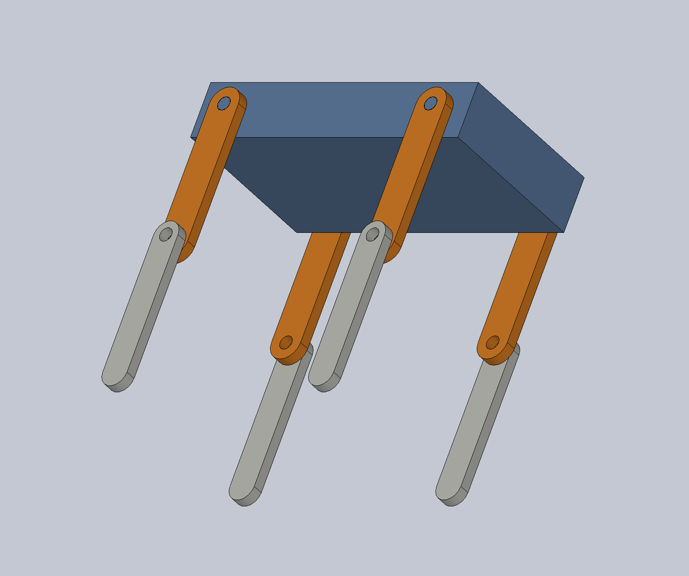
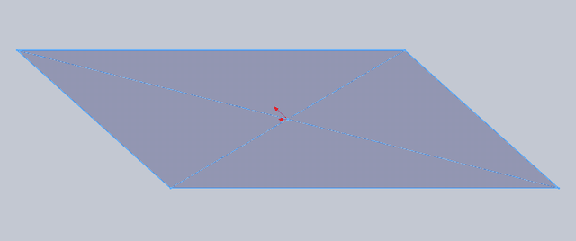
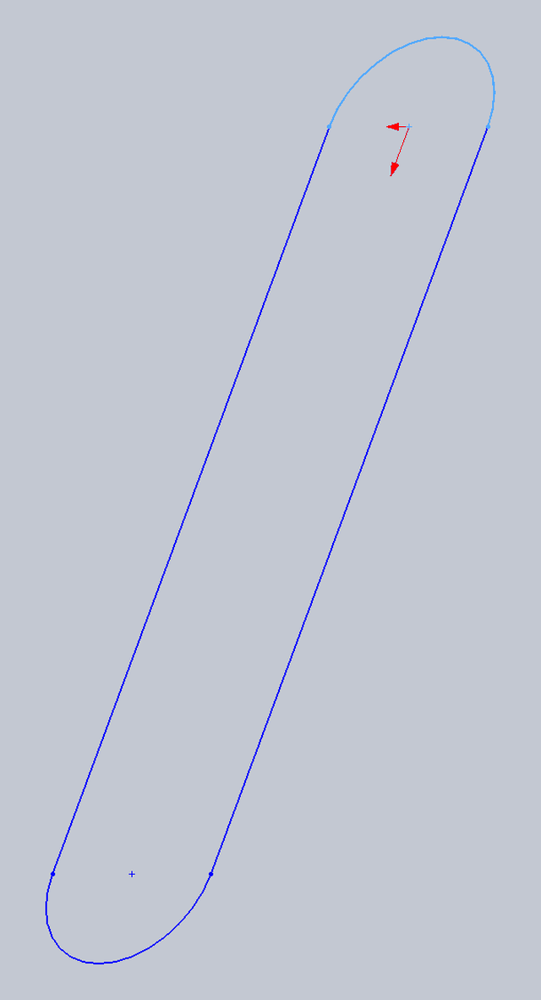
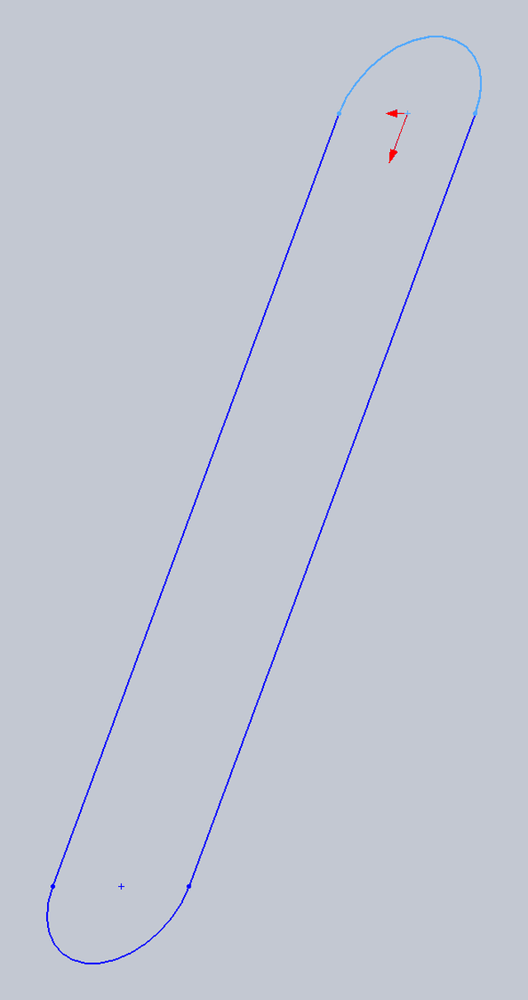
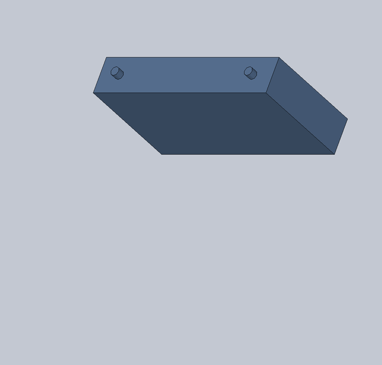
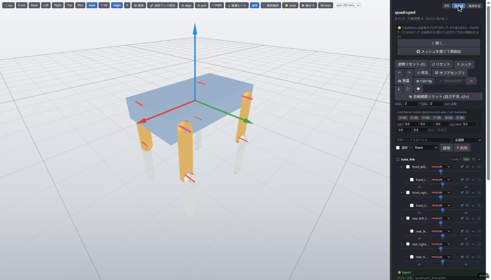
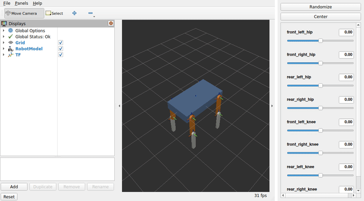

# チュートリアル: 4脚ロボットをゼロから作る

SolidWorks で簡単な 4 脚ロボットを作り、sw2robot で URDF にします。
運動学の木構造をどこかに手で書く必要はありません。**普通の合致でロボットを
組み立てれば、sw2robot がそこから関節を読み取ります。**

{ width="560" }

| | |
| --- | --- |
| 部品 | 部品ファイル 3 つ: `body`・`thigh`・`shin`（脚はそれぞれ 4 個ずつ使う） |
| 結果 | 9 リンク、回転関節 8 個（各脚に股関節と膝）、1.24 kg |
| 所要時間 | 手作業で 20 分ほど。ビルドスクリプトなら 15 秒 |

ここで出てくるものは、SolidWorks のファイル、それを作るスクリプト、抽出済みの
パッケージも含めてすべて
[`examples/quadruped`](https://github.com/jsk-ros-pkg/solidworks_urdf_exporter2/tree/main/examples/quadruped)
にあります。

!!! tip "SolidWorks がない場合"
    手順 1〜3 には Windows 上の SolidWorks が必要です。サンプルフォルダには
    抽出済みの `graph.json` が入っているので、どの OS でも
    [手順 4](#clean-up) から始められます。

## 0. 準備

- Windows 上の **SolidWorks 2024 以降**（サンプルファイルは 2024 SP5 で保存して
  あり、それより古いバージョンでは開けません）
- **sw2robot**: ビルド済みエディタ（[インストール](index.md#install)）か、コマンド
  ラインツール（`pip install sw2robot`、またはこのリポジトリを clone して
  `uv run`）

単位は **mm**、向きは **Z が上、X が前、Y が左** で作ります。これは ROS の
慣例（[REP 103](https://www.ros.org/reps/rep-0103.html)）なので、URDF に余計な
回転を入れずに済みます。SolidWorks の標準ビューは Y が上の前提なので、
「等角投影」ビューではロボットが仰向けに見えます。変わるのは見え方だけで、
モデル自体は正しい向きです。

SolidWorks の参照平面との対応:

| 平面 | 張る軸 | ここでの使い方 |
| --- | --- | --- |
| 正面 | X–Y | 地面（上から見た面） |
| 平面 | X–Z | 側面図。脚はここに描く |
| 右側面 | Y–Z | 使わない |

## 1. 3 つの部品を作る

どの部品も押し出し 1〜2 回でできます。それぞれ **材料の編集** で **ABS** を
設定してください。sw2robot は質量・重心・慣性テンソルを SolidWorks から直接
受け取るので、材料が URDF の `<inertial>` を決めます。

=== "body（胴体）"

    { width="380" align=right }

    1. **正面** に、原点を中心とした **中心点矩形** 220 × 120 mm を描く。
    2. **押し出しボス/ベース**、**中間平面**、40 mm（z = −20〜20）。
    3. +Y 側の側面に **Ø10 の円** を x = +85 と x = −85（z = 0）に描き、
       外向きに **8 mm** 押し出す。これが股関節の軸になる。
    4. −Y 側の側面にも同じものを作る。

=== "thigh（大腿）"

    { width="200" align=right }

    1. **平面** に、幅 24 mm・中心間距離 100 mm の **ストレートスロット** を
       描く。片方の中心は原点、もう片方は z = −100（原点の下）。
    2. スロットの両方の中心に **Ø10 の円** を描く。
    3. **押し出しボス/ベース** 8 mm（y = 0〜8）。2 つの円がそれぞれ股関節の穴と
       膝の穴になる。

=== "shin（下腿）"

    { width="200" align=right }

    大腿と同じ作り方で、幅を **20 mm** にし、**穴は上だけ** にします。
    丸い下端が足先になります。

部品の原点をどこに置くかは、sw2robot には関係ありません。関節軸は部品の
座標系ではなく合致から決まります。上の原点の置き方は、組み立てを楽にする
ためのものです。

## 2. 合致で組み立てる

アセンブリを新規作成し、**最初に `body` を挿入** します。最初の構成部品は
固定され、ロボットのルート（`base_link`）になります。続いて `thigh` を 4 個、
`shin` を 4 個、左前・右前・左後・右後の順に挿入します。SolidWorks は
インスタンスに `thigh-1` 〜 `thigh-4` と番号を振り、sw2robot はそこから
`thigh_1` 〜 `thigh_4` というリンク名を作ります。

1 つの関節は **2 つの合致** でできています。

{ width="560" }

| 関節 | 同心円（軸） | 一致（面が接する） |
| --- | --- | --- |
| 股関節 | 大腿の上の穴 ↔ 胴体の軸 | 大腿の平らな面 ↔ 胴体の側面 |
| 膝 | 下腿の穴 ↔ 大腿の下の穴 | 下腿の平らな面 ↔ 大腿の外側の面 |

同心円だけでは、軸まわりの回転と軸方向のスライドが残ります。一致でスライドが
止まり、**回転の自由度が 1 つだけ残ります。これを sw2robot は `revolute`
（回転関節）として書き出します。** 右側の脚は **合致の整列反転** を使って、
リンクが胴体の外側に来るようにします。

!!! check "保存する前の確認"
    マウスで脚をドラッグしてみてください。軸まわりに回るだけで、他には
    動かないはずです。動かない場合は、余計な合致（平行、角度、別の軸への
    2 つ目の同心円など）で固定されています。sw2robot はそのペアを `fixed`
    として書き出します。逆に何通りにも動くなら、合致が足りません。

他の合致の組み合わせの扱い:

- **完全拘束**: 一体として扱われる（`fixed`）
- **同心円 + 一致**（今回）: `revolute`
- **制限合致**（ヒンジの角度制限、スライダーの距離制限）: その範囲が URDF の
  `<limit>` になる

アセンブリを `quadruped.SLDASM` として保存します。

??? example "近道: 手順 1〜2 をスクリプトで作る"
    [`build_cad.py`](https://github.com/jsk-ros-pkg/solidworks_urdf_exporter2/blob/main/examples/quadruped/build_cad.py)
    は、上の手順（スケッチ、押し出し、挿入、16 個の合致）をそのまま
    SolidWorks API で実行します。

    ```bash
    uv run python examples/quadruped/build_cad.py --out my_quadruped
    ```

    既存のファイルは `--overwrite` を付けない限り上書きしません。
    `--record DIR` を付けると手順ごとにフレームを保存し、このページの
    アニメーション（`body.gif`・`thigh.gif`・`shin.gif`・`assembly.gif`）を
    書き出します。`--screenshots DIR` は静止画を保存します。

## 3. URDF を抽出する

=== "エディタ"

    `sw2robot-web` を起動し、**開く…** を押して `quadruped.SLDASM` のフルパスを
    貼り付けます。エディタが裏で SolidWorks を動かし、ロボットを表示します。

=== "コマンドライン"

    ```bash
    sw2urdf examples/quadruped/cad/quadruped.SLDASM -o examples -n quadruped
    ```

元の CAD ファイルは変更されません。sw2robot は使い捨てのコピーを読み取り専用で
開きます。20 秒ほどで終わり、最後にこう表示されます。

```text
[build] model from graph ...
      base link: body_1
      joint types: 8 revolute, 0 prismatic, 0 fixed
      9 links, 8 joints
      inertia: 9 from solidworks
```

パッケージフォルダ（`examples/quadruped/`）の中身:

```text
graph.json              SolidWorks から読んだすべて（これ以降 SolidWorks は不要）
quadruped.joints.yaml   関節設定。編集できる運動学の木構造そのもの
meshes/*.3dxml          部品ごとのメッシュ
urdf/quadruped.urdf     URDF
```

## 4. 確認して整える {#clean-up}

合致から *木構造* は正しく出ました。ただ、次の 3 点がまだロボットではなく
CAD の言葉のままです。

1. **名前**: リンクは `thigh_1` 〜 `shin_4`、関節は `body_1__thigh_1` など。
2. **可動範囲**: 拘束のないヒンジは −π〜π で書き出される。
3. **軸の向き**: 各関節の軸は同心円合致から取られる。右脚の膝だけ軸が +Y を
   向き、他の関節はすべて −Y を向いている。このままだと同じ角度で左右の膝が
   逆に曲がる。

=== "エディタ"

    

    パッケージを開きます（`sw2robot-web examples/quadruped`）。右側の木構造に
    関節ごとのスライダーがあり、ドラッグすると動きます。

    - **= 改名**: リンクと関節に分かりやすい名前を付ける。
    - 右膝を選んで **`f`** を押し、軸を反転する。
    - 各関節の行で可動範囲を設定する。リンク同士がぶつかるロボットなら、
      **自動関節リミット** が自己干渉の掃引から範囲を求める。

    変更はすべて `quadruped.joints.yaml` に保存されます（反転は
    `flip_axis: true`）。再ビルドや再抽出をしても残ります。

=== "joints.yaml"

    `quadruped.joints.yaml` を直接編集します。サンプルフォルダに入っている
    版:

    ```yaml
    base: body_1
    joints:
      - parent: body_1
        child:  thigh_1
        type:   revolute
        lower: -1.57
        upper: 1.57
      # ... 股関節と膝ごとに 1 項目 ...
      - parent: thigh_2
        child:  shin_2
        type:   revolute
        lower: -2.5
        upper: 2.5
        axis_dir: [0, -1, 0]   # 右膝の軸を -Y に向ける

    link_names:
      thigh_1: front_left_thigh
      shin_1: front_left_shin
      # ...
    joint_names:
      body_1__thigh_1: front_left_hip
      thigh_1__shin_1: front_left_knee
      # ...
    ```

    再ビルドします。`graph.json` を読むだけなので SolidWorks は不要です。

    ```bash
    python -m sw2robot.exporter.build examples/quadruped \
        --config examples/quadruped/quadruped.joints.yaml
    ```

!!! warning "再抽出すると関節設定は上書きされる"
    `--config` なしで `sw2urdf` をもう一度実行すると、`quadruped.joints.yaml` が
    新しく書き直されます。編集した後に再抽出するときは
    `--config examples/quadruped/quadruped.joints.yaml` を付けてください。

### 関節原点の位置 {#joint-origin}

回転関節の原点は、**軸の上で、一致合致の面が接している位置** に置かれます。
股関節なら胴体の側面（y = ±0.060）です。別の位置にしたい場合は、
`quadruped.joints.yaml` のその関節に `axis_point: [x, y, z]`（メートル、
アセンブリ座標系）を書きます。

## 5. 結果

```xml
<joint name="front_left_hip" type="revolute">
  <origin xyz="0.085 0.06 0" rpy="0 0 0"/>
  <parent link="base_link"/>
  <child link="front_left_thigh"/>
  <axis xyz="0 -1 0"/>
  <limit lower="-1.57" upper="1.57" effort="10" velocity="3.14"/>
</joint>
```

8 個の関節がすべて −Y まわりに回るので、正の角度を与えるとどの足も前に
振れます。総質量は 1.241 kg で、SolidWorks が計算した ABS の胴体（1.080 kg）、
22.0 g の大腿 4 本、18.2 g の下腿 4 本の合計です。

用途に合わせて書き出します。

```bash
# ROS 2 パッケージ（package:// URL、.dae メッシュ、launch/ と rviz/ 付き）
python -m sw2robot.exporter.build examples/quadruped \
    --config examples/quadruped/quadruped.joints.yaml --ros2

# MuJoCo モデル（MJCF + STL）。足の接触と IMU サイト付き
python -m sw2robot.exporter.build examples/quadruped \
    --config examples/quadruped/quadruped.joints.yaml --mujoco
```

エディタの **Export** 欄にも同じボタン（**⬇ ROS2 パッケージ**、
**⬇ MuJoCo (MJCF)**）があります。

### RViz2 で見る

**Export** 欄の **🚀 ROS 2マシンでビルド＆起動 (curl | bash)** の下に、1 行のコマンドが
表示されます。クリックするとコピーされるので、エディタを起動したまま、ROS 2 の入った
マシンの端末に貼り付けて実行します（同じ PC の WSL 2 でも動きます）。エディタから
ROS 2 パッケージを取ってきて `colcon` でビルドし、`display.launch.py`
（`robot_state_publisher`、関節スライダーの GUI、RViz2）を起動します。

```bash
bash -c 'for H in localhost:8090 $(ip route show default 2>/dev/null | cut -d" " -f3):8090; do curl -fs http://$H/api/launch_it.sh && break; done' | bash
```

（ポート番号はエディタのものです。手で打たずに、Export 欄からコピーしてください。）

{ width="720" }

RViz2 は最初からロボット全体が収まる視点で開きます。スライダーを動かすと、その関節が回ります。
WSL 2 と ROS 2 Jazzy で試したところ、ビルドは 3.4 秒でした。

## 次のステップ

- [MuJoCo で歩かせる](walk.md): このロボットを MuJoCo に書き出し、強化学習で
  トロット歩行させます（CPU で動きます）。
- 実際のサーボを使う: サーボ本体とホーンをアセンブリに入れ、ホーンをサーボの
  出力軸に同心円で合致させます。ルールは同じ 2 つの合致で、ネジで留めた部品は
  `fixed` になります。
- 片側だけモデリングする: 関節設定の `mirror_limbs:` で反対側の脚を生成
  できます。
- エディタの全機能とキーボードショートカットは
  [README](https://github.com/jsk-ros-pkg/solidworks_urdf_exporter2#readme)
  にあります。
