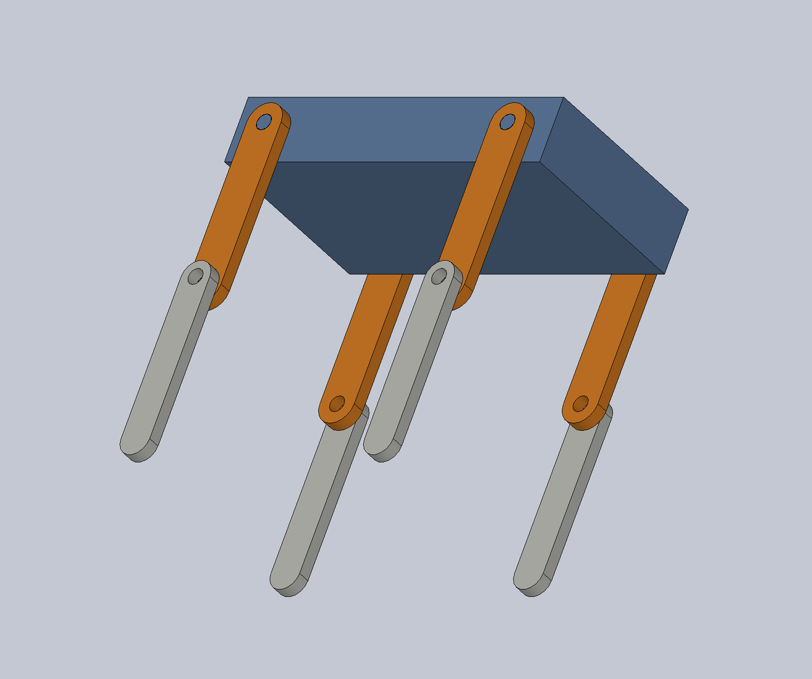
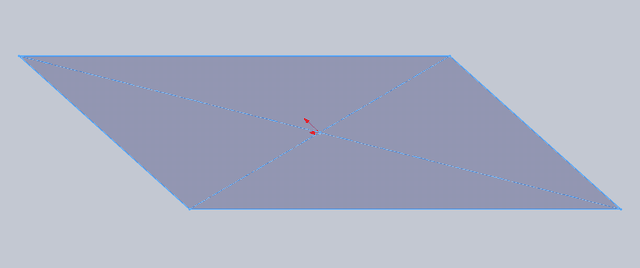
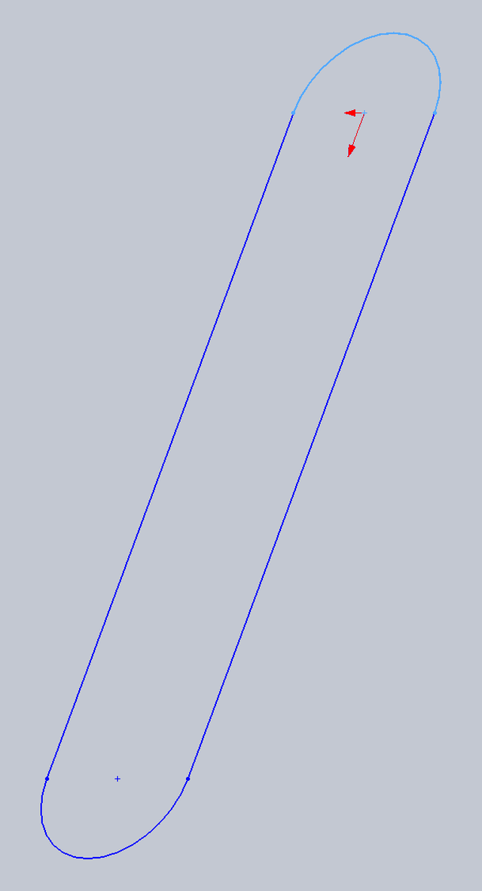
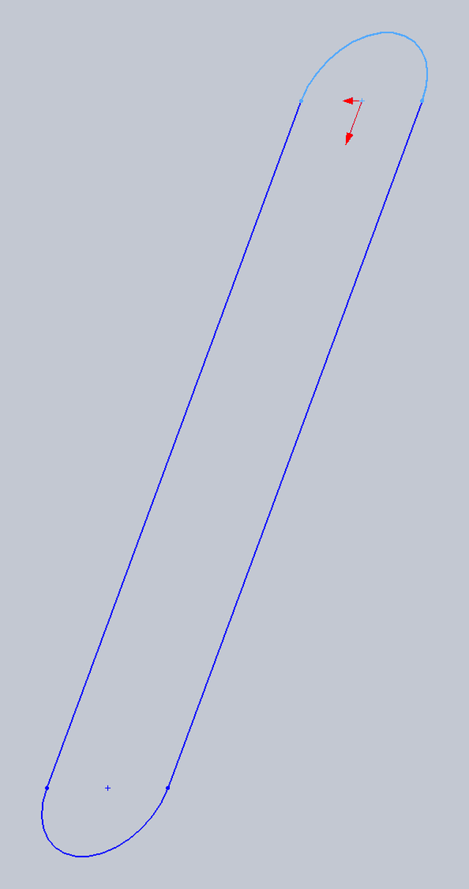
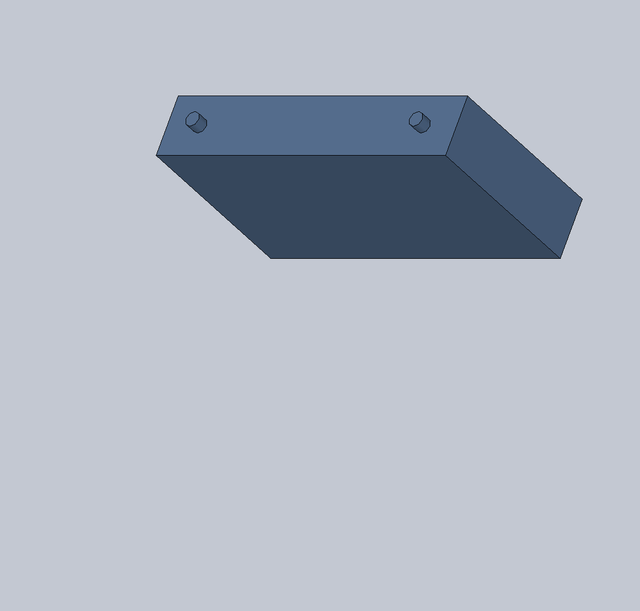
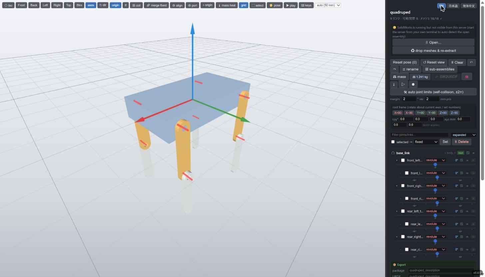
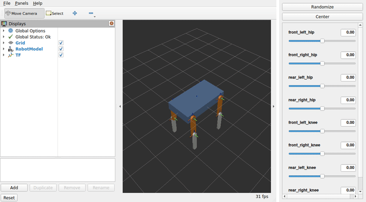

# Tutorial: a quadruped from scratch

This tutorial builds a simple four-legged robot in SolidWorks and turns it into
a URDF with sw2robot. You don't author a kinematic tree anywhere: **you assemble
the robot with ordinary mates, and sw2robot reads the joints back from them.**

{ width="560" }

| | |
| --- | --- |
| Parts | 3 part files: `body`, `thigh`, `shin` (4 instances each of the legs) |
| Result | 9 links, 8 revolute joints (a hip and a knee per leg), 1.24 kg |
| Time | about 20 minutes by hand, or 15 seconds with the build script |

Everything shown here is in
[`examples/quadruped`](https://github.com/jsk-ros-pkg/solidworks_urdf_exporter2/tree/main/examples/quadruped):
the SolidWorks files, the script that builds them, and the extracted package.

!!! tip "No SolidWorks?"
    Steps 1–3 need SolidWorks on Windows. The example folder already holds the
    extracted `graph.json`, so you can start at [step 4](#clean-up)
    on any OS.

## 0. Before you start

- **SolidWorks 2024 or later** on Windows (the example files are saved in 2024
  SP5 and do not open in older releases).
- **sw2robot**: either the prebuilt editor (see [Install](index.md#install))
  or the command-line tools (`pip install sw2robot`, or `uv run` inside a clone
  of this repository).

Model in **millimetres** with **Z up, X forward, Y left**, the ROS convention
([REP 103](https://www.ros.org/reps/rep-0103.html)). The URDF then needs no
extra rotation. SolidWorks' own named views assume Y up, so the robot will lie
on its back in the *Isometric* view. That only affects the view, not the model.

In the SolidWorks reference planes this means:

| Plane | Spans | Used here as |
| --- | --- | --- |
| Front Plane | X–Y | the ground plane (seen from above) |
| Top Plane | X–Z | the side view, where the legs are drawn |
| Right Plane | Y–Z | — |

## 1. Model the three parts

Each part is one or two extrusions. For each, set the material to **ABS**
(*Edit Material*): sw2robot takes mass, centre of mass and inertia straight from
SolidWorks, so the material is what makes the URDF's `<inertial>` right.

=== "body"

    { width="380" align=right }

    1. Sketch a **centre rectangle** 220 × 120 mm on the **Front Plane**,
       centred on the origin.
    2. **Extrude Boss**, *Mid Plane*, 40 mm, so the box spans z = −20…20.
    3. Sketch two **Ø10 circles** on the +Y side face at x = +85 and x = −85,
       z = 0, and extrude them **8 mm** outward. These are the hip axles.
    4. Do the same on the −Y side face.

=== "thigh"

    { width="200" align=right }

    1. On the **Top Plane**, sketch a **straight slot** 24 mm wide with its
       two centres 100 mm apart: one at the origin, the other at z = −100
       (below the origin).
    2. Add a **Ø10 circle** at each slot centre.
    3. **Extrude Boss** 8 mm, so the link spans y = 0…8. The circles become
       the hip hole and the knee hole.

=== "shin"

    { width="200" align=right }

    Like the thigh, but **20 mm** wide and with **only the top hole**. The
    rounded bottom end is the foot.

Where you put a part's origin does not matter to sw2robot. Joint axes come
from the mates, not from part frames. The origins above only keep the
assembly step tidy.

## 2. Assemble with mates

Create an assembly and insert **`body` first**: the first component is fixed,
and it becomes the robot's root (`base_link`). Then insert four `thigh`s and
four `shin`s, in the order front-left, front-right, rear-left, rear-right.
SolidWorks numbers the instances `thigh-1` … `thigh-4`, and sw2robot names the
links `thigh_1` … `thigh_4` from them.

Each joint is **two mates**:

{ width="560" }

| Joint | Concentric (the axis) | Coincident (the faces touching) |
| --- | --- | --- |
| hip | the thigh's top hole ↔ a body axle | the thigh's flat face ↔ the body's side face |
| knee | the shin's hole ↔ the thigh's lower hole | the shin's flat face ↔ the thigh's outer face |

Concentric leaves rotation about and sliding along the axis; coincident takes
the sliding away. **One rotational degree of freedom is left, and that is what
sw2robot exports as a `revolute` joint.** For the right-hand legs, use *Flip
mate alignment* so the link sits outside the body.

!!! check "Check before you save"
    Drag a leg with the mouse. It should swing about its axle and do nothing
    else. If it is stuck, an extra mate has fixed it: a *Parallel*, an *Angle*,
    or a second concentric on another axis. sw2robot would export that pair
    as `fixed`. If it moves in more ways than one, a mate is missing.

What sw2robot makes of other mate combinations:

- **Fully constrained**: the pair is welded together (`fixed`).
- **Concentric + coincident** (as here): `revolute`.
- **A limit mate** (an angle limit on a hinge, a distance limit on a slider):
  its range becomes the URDF `<limit>`.

Save the assembly as `quadruped.SLDASM`.

??? example "Shortcut: let the script build steps 1–2"
    [`build_cad.py`](https://github.com/jsk-ros-pkg/solidworks_urdf_exporter2/blob/main/examples/quadruped/build_cad.py)
    does exactly the above over the SolidWorks API (sketch, extrude, insert,
    and the 16 mates):

    ```bash
    uv run python examples/quadruped/build_cad.py --out my_quadruped
    ```

    It refuses to overwrite existing files unless you pass `--overwrite`.
    `--record DIR` also saves a frame after every step and writes the
    animations on this page (`body.gif`, `thigh.gif`, `shin.gif`,
    `assembly.gif`); `--screenshots DIR` saves the stills.

## 3. Extract the URDF

=== "Editor"

    Start `sw2robot-web`, click **Open…**, and paste the full path of
    `quadruped.SLDASM`. The editor drives a hidden SolidWorks, then shows the
    robot.

=== "Command line"

    ```bash
    sw2urdf examples/quadruped/cad/quadruped.SLDASM -o examples -n quadruped
    ```

Your CAD file is never modified: sw2robot opens a throwaway copy read-only.
The run takes about 20 seconds and ends with:

```text
[build] model from graph ...
      base link: body_1
      joint types: 8 revolute, 0 prismatic, 0 fixed
      9 links, 8 joints
      inertia: 9 from solidworks
```

The package folder (`examples/quadruped/`) now holds:

```text
graph.json              everything read from SolidWorks (no SolidWorks needed after this)
quadruped.joints.yaml   the joint config: the kinematic tree you can edit
meshes/*.3dxml          one mesh per part
urdf/quadruped.urdf     the URDF
```

## 4. Check and clean up {#clean-up}

The mates gave the right *tree*, but three things still read like CAD rather
than like a robot:

1. **Names.** The links are `thigh_1` … `shin_4`, and the joints
   `body_1__thigh_1` and so on.
2. **Limits.** A free hinge exports as −π…π.
3. **Axis sense.** Each joint's axis is taken from its concentric mate. On the
   right-hand legs, the knee axis points +Y where every other joint's points
   −Y, so the same angle would bend the left and right knees opposite ways.

=== "Editor"

    

    Open the package (`sw2robot-web examples/quadruped`). Every joint gets a
    slider in the tree on the right; drag one to see it move.

    - **= rename**: give links and joints readable names.
    - Select a right knee and press **`f`** to flip its axis.
    - Set each joint's limits in its row. On a robot whose links can hit
      each other, **auto joint limits** finds them from a self-collision sweep.

    Every change is saved into `quadruped.joints.yaml` (a flip as
    `flip_axis: true`), so it survives a rebuild or a re-extract.

=== "joints.yaml"

    Edit `quadruped.joints.yaml` by hand. This is the version in the example
    folder:

    ```yaml
    base: body_1
    joints:
      - parent: body_1
        child:  thigh_1
        type:   revolute
        lower: -1.57
        upper: 1.57
      # ... one entry per hip and knee ...
      - parent: thigh_2
        child:  shin_2
        type:   revolute
        lower: -2.5
        upper: 2.5
        axis_dir: [0, -1, 0]   # turn the right knee's axis to -Y

    link_names:
      thigh_1: front_left_thigh
      shin_1: front_left_shin
      # ...
    joint_names:
      body_1__thigh_1: front_left_hip
      thigh_1__shin_1: front_left_knee
      # ...
    ```

    Rebuild. This needs no SolidWorks; it only reads `graph.json`:

    ```bash
    python -m sw2robot.exporter.build examples/quadruped \
        --config examples/quadruped/quadruped.joints.yaml
    ```

!!! warning "Re-extracting overwrites the joint config"
    Running `sw2urdf` again without `--config` writes a fresh
    `quadruped.joints.yaml`. After editing it, re-extract with
    `--config examples/quadruped/quadruped.joints.yaml`.

### Where the joint origin ends up {#joint-origin}

A revolute joint's origin is placed **on its axis, where the coincident mate's
faces touch**: for a hip, on the body's side face (y = ±0.060). To put it
somewhere else, set `axis_point: [x, y, z]` (metres, assembly frame) on that
joint in `quadruped.joints.yaml`.

## 5. The result

```xml
<joint name="front_left_hip" type="revolute">
  <origin xyz="0.085 0.06 0" rpy="0 0 0"/>
  <parent link="base_link"/>
  <child link="front_left_thigh"/>
  <axis xyz="0 -1 0"/>
  <limit lower="-1.57" upper="1.57" effort="10" velocity="3.14"/>
</joint>
```

All eight joints now turn about −Y, so one positive angle swings every foot
forward. The total mass is 1.241 kg: the ABS body (1.080 kg) plus four
22.0 g thighs and four 18.2 g shins, as SolidWorks computed them.

Export it for where it is going:

```bash
# a ROS 2 package (package:// URLs, .dae meshes, launch/ + rviz/)
python -m sw2robot.exporter.build examples/quadruped \
    --config examples/quadruped/quadruped.joints.yaml --ros2

# a MuJoCo model (MJCF + STL), with foot contacts and an IMU site
python -m sw2robot.exporter.build examples/quadruped \
    --config examples/quadruped/quadruped.joints.yaml --mujoco
```

The editor's **Export** panel has the same as buttons (**⬇ ROS2 package**,
**⬇ MuJoCo (MJCF)**).

### See it in RViz2

The **Export** panel also prints a one-liner under **🚀 build + launch on a
ROS 2 machine (curl | bash)**. Click it to copy it and run it in a terminal on
a machine with ROS 2, while the editor is running (WSL 2 on the same PC works).
It downloads the ROS 2 package from the editor, builds it with `colcon` and
starts `display.launch.py`: `robot_state_publisher`, the joint slider GUI and
RViz2.

```bash
bash -c 'for H in localhost:8090 $(ip route show default 2>/dev/null | cut -d" " -f3):8090; do curl -fs http://$H/api/launch_it.sh && break; done' | bash
```

(The port is the editor's; copy the line from the panel rather than typing it.)

{ width="720" }

RViz2 opens already framed on the robot. Dragging a slider moves its joint.
Measured on WSL 2 with ROS 2 Jazzy, the build took 3.4 s.

## Where to go next

- [Make it walk in MuJoCo](walk.md): export this robot to MuJoCo and
  train it to trot with reinforcement learning, on a CPU.
- Real servos: put the servo body and its horn in the assembly and mate the
  horn concentric to the servo shaft. The same two-mate rule applies, and
  everything bolted together comes out `fixed`.
- Model one side only: the `mirror_limbs:` key in the joint config generates
  the mirrored legs.
- The [README](https://github.com/jsk-ros-pkg/solidworks_urdf_exporter2#readme)
  lists every editor feature and keyboard shortcut.
