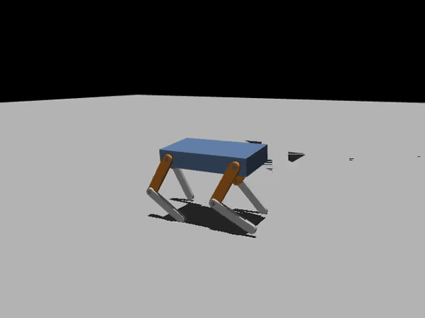

# MuJoCo で歩かせる

[チュートリアル](tutorial.md) は URDF ができたところで終わります。このページでは、
同じ 4 脚ロボットを MuJoCo に持っていき、強化学習で歩かせます。GPU は不要で、
CPU で 1 時間弱です。

{ width="480" }

学習コードは sw2robot には含まれていません。書籍『つくりながら学ぶ！リアルタイムOS自作入門』の
CPU 版の学習コード
[`code/13_quadruped/rl/cpu`](https://github.com/iory/build-your-own-arduino-rtos/tree/main/code/13_quadruped/rl/cpu)
（[iory/build-your-own-arduino-rtos](https://github.com/iory/build-your-own-arduino-rtos)）を使います。
これは書籍のサーボ 8 個の 4 脚ロボット用ですが、関節の構成（各脚に前後に振る股関節と膝）が
このロボットと同じなので、学習コードが期待する名前と形でロボットを書き出せば使えます。
その作業のほとんどは sw2robot のエディタでできます。

| | |
| --- | --- |
| 必要なもの | `examples/quadruped` のパッケージ（またはチュートリアルで作ったもの）、Linux か WSL 2、[uv](https://docs.astral.sh/uv/) |
| 学習 | `ArduinoQuad-Walk`、PPO（rsl-rl）、CPU で 2048 台を並列 |
| 実測 | 1200 iteration が 52 分（WSL 2、12 スレッド） |

## 1. 学習コードが期待する名前にする

学習コードは関節や足先を名前で探し、関節の並び順も確認します。パッケージをエディタで開き
（`sw2robot-web examples/quadruped`）、次のようにします。

1. **= 改名** で関節とリンクの名前を変える

    | CAD | 関節 | リンク |
    | --- | --- | --- |
    | 左前（`thigh_1`, `shin_1`） | `FL_hip_joint`, `FL_knee_joint` | `FL_thigh`, **`FL`** |
    | 左後（`thigh_3`, `shin_3`） | `RL_hip_joint`, `RL_knee_joint` | `RL_thigh`, **`RL`** |
    | 右後（`thigh_4`, `shin_4`） | `RR_hip_joint`, `RR_knee_joint` | `RR_thigh`, **`RR`** |
    | 右前（`thigh_2`, `shin_2`） | `FR_hip_joint`, `FR_knee_joint` | `FR_thigh`, **`FR`** |

    下腿のリンク名は脚の名前そのもの（`FL_shin` ではなく `FL`）にします。MuJoCo の書き出しは、
    足先の接触球を `<リンク名>_toe`、サイトを `<リンク名>` と名付け、学習コードは `FL_toe` と
    `FL` という名前のサイトを探すためです。

2. **右膝** を 1 つずつ選んで **`f`** を押し、すべての関節が同じ向きに回るようにする
   （チュートリアルの手順 4 と同じ）

3. 各関節の **Actuator & physics** で、effort を **2.942** N·m、velocity を **4.717** rad/s
   にする。学習コードのモーターモデルが前提にしている Feetech STS3215（12 V）の値です。
   可動範囲は股関節 ±1.57、膝 ±2.5。

4. **関節の並び順**: 学習コードは脚を FL → RL → RR → FR の順（各脚は股関節 → 膝）で
   並んでいることを前提にします。エディタにはこれを変える操作がなく、`quadruped.joints.yaml`
   の `joints:` の並びで決まるので、手で並べ替えます。

    ```yaml
    joints:
      - parent: body_1      # FL 股関節
        child:  thigh_1
        type:   revolute         # ... 可動範囲・effort・velocity・flip_axis の行はそのまま
      - parent: thigh_1      # FL 膝
        child:  shin_1
        type:   revolute         # ... 可動範囲・effort・velocity・flip_axis の行はそのまま
      - parent: body_1      # RL 股関節
        child:  thigh_3
        type:   revolute         # ... 可動範囲・effort・velocity・flip_axis の行はそのまま
      - parent: thigh_3      # RL 膝
        child:  shin_3
        type:   revolute         # ... 可動範囲・effort・velocity・flip_axis の行はそのまま
      - parent: body_1      # RR 股関節
        child:  thigh_4
        type:   revolute         # ... 可動範囲・effort・velocity・flip_axis の行はそのまま
      - parent: thigh_4      # RR 膝
        child:  shin_4
        type:   revolute         # ... 可動範囲・effort・velocity・flip_axis の行はそのまま
      - parent: body_1      # FR 股関節
        child:  thigh_2
        type:   revolute         # ... 可動範囲・effort・velocity・flip_axis の行はそのまま
      - parent: thigh_2      # FR 膝
        child:  shin_2
        type:   revolute         # ... 可動範囲・effort・velocity・flip_axis の行はそのまま
    ```

    （各項目の可動範囲・`effort`・`velocity`・`flip_axis` は、上の手順で入れたものを残してください。）
    並べ替えたら、エディタでパッケージを開き直します。

## 2. MJCF を書き出す

エディタの **Export** 欄の **⬇ MuJoCo (MJCF)** を押します。コマンドラインなら:

```bash
python -m sw2robot.exporter.build examples/quadruped \
    --config examples/quadruped/quadruped.joints.yaml --mujoco
```

`quadruped_mjcf` パッケージの `mjcf/quadruped.xml` には、浮遊ベース、8 個の関節、各足の接触球
`FL_toe` … とサイト `FL` …、学習コードが読む `imu_*` と `root_angmom` のセンサーが入っています。
アクチュエータと初期姿勢（keyframe）は、学習コードが自分のものに置き換えます。

## 3. 学習コードの準備

```bash
git clone https://github.com/iory/build-your-own-arduino-rtos
cd build-your-own-arduino-rtos/code/13_quadruped/rl/cpu
```

`task.py` の中で書籍のロボット専用なのは、立ち姿勢（胴体の高さ → 股関節・膝の角度の表）だけです。
このロボットでは、足先を股関節の真下に置くと `膝 = -2 × 股関節`、`高さ = 0.2 × cos(股関節) + 0.01`
になります。表と既定値を次のように置き換えます。

```python
HOME_TABLE = {  # sw2robot のチュートリアルの4脚ロボット
    0.13: (0.9273, -1.8546),
    0.14: (0.8632, -1.7264),
    0.15: (0.7954, -1.5908),
    0.16: (0.7227, -1.4455),
    0.17: (0.6435, -1.2870),
}
HOME_BASE_HEIGHT = round(_f("ARDUINO_QUAD_HOME_HEIGHT", "0.15"), 2)
```

!!! tip "GPU がない場合"
    `uv sync` は Linux 向けの通常版 PyTorch を入れ、CUDA のライブラリ（数 GB）も一緒に落とします。
    学習はすべて CPU で動くので CPU 版で十分です。`uv sync` の前に `pyproject.toml` に次を足します。

    ```toml
    [tool.uv.sources]
    torch = [{ index = "pytorch-cpu" }]

    [[tool.uv.index]]
    name = "pytorch-cpu"
    url = "https://download.pytorch.org/whl/cpu"
    explicit = true
    ```

## 4. 学習する

```bash
uv sync
export ARDUINO_QUAD_XML=/path/to/quadruped_mjcf/mjcf/quadruped.xml
export ARDUINO_QUAD_HOME_HEIGHT=0.15 ARDUINO_QUAD_GAIT_PERIOD=0.32
uv run train.py --num-envs 2048 --iterations 1200 --seed 1
```

最初の数百 iteration で転ばなくなり（エピソード長が上限の 1000 ステップに達する）、
600 iteration で指令の範囲が広がってから前に歩くようになります。

## 5. 歩かせて確かめる

```bash
MUJOCO_GL=egl uv run evaluate.py \
    --checkpoint logs/rsl_rl/arduino_quad_velocity/<run>/model_1200.pt --video walk.mp4
```

`evaluate.py` は指令ごとに 64 台を 20 秒歩かせて、速さなどを測ります。上の方策での実測:

| 指令（前進 m/s, 旋回 rad/s） | 前進 | 旋回 | 転倒（64 台中） |
| --- | --- | --- | --- |
| 0.06, 0 | 0.079 | 0.015 | 0 |
| 0.09, 0 | 0.109 | 0.041 | 0 |
| 0.12, 0 | 0.118 | 0.028 | 0 |
| 0, 0.3 | −0.001 | 0.172 | 0 |
| 0.06, −0.3 | 0.062 | −0.114 | 0 |

`--dr`（学習時と同じように質量・摩擦・サーボのゲインをばらつかせる）を付けても転倒は 0 で、
0.09 の指令で 0.089 m/s 進みます。

前進の指令には付いてきて、転びませんが、歩き方はまだ荒削りです。

- **旋回**は指令の半分ほど（0.3 に対して 0.17 rad/s）で、まっすぐ歩くときも少し左に曲がります。
- **足が滑ります**（55〜68 mm/s）。胴体が中身の詰まった ABS の塊（1.08 kg）で、脚は 1 本約 40 g、
  足先は小さな丸です。まず試すなら、胴体を中空にするか、足先の接触球を大きくすることです。
- **長く学習させる**と良くなります。同じロボットの別の学習（足先の球を書き出しの 4 mm ではなく 10 mm にした手作りの MJCF）では、
  2300 iteration（約 100 分）で旋回とまっすぐ歩くときの曲がりが改善しました。
