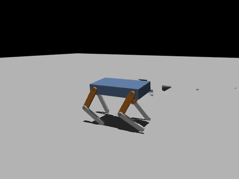

# Make it walk in MuJoCo

The [tutorial](tutorial.md) ends with a URDF. This page takes the same
quadruped into MuJoCo and trains it to walk with reinforcement learning, on a
CPU, in under an hour.

{ width="480" }

The trainer is not part of sw2robot. It is the CPU trainer of the book
*つくりながら学ぶ！リアルタイムOS自作入門*:
[`code/13_quadruped/rl/cpu`](https://github.com/iory/build-your-own-arduino-rtos/tree/main/code/13_quadruped/rl/cpu)
in [iory/build-your-own-arduino-rtos](https://github.com/iory/build-your-own-arduino-rtos).
It trains the book's own 8-servo quadruped, which has the same layout as ours
(a hip and a knee per leg, both pitching), so the robot only has to be
described the way that trainer expects. sw2robot's editor does almost all of
that.

| | |
| --- | --- |
| You need | the `examples/quadruped` package (or your own from the tutorial), Linux or WSL 2, [uv](https://docs.astral.sh/uv/) |
| Training | `ArduinoQuad-Walk`, PPO (rsl-rl), 2048 robots in parallel on the CPU |
| Measured | 1200 iterations in 52 min on 12 CPU threads (WSL 2) |

## 1. Name the robot the way the trainer expects

The trainer finds everything by name, and checks the joint order. Open the
package in the editor (`sw2robot-web examples/quadruped`) and:

1. **= rename** the joints and links:

    | CAD | joint | link |
    | --- | --- | --- |
    | front left (`thigh_1`, `shin_1`) | `FL_hip_joint`, `FL_knee_joint` | `FL_thigh`, **`FL`** |
    | rear left (`thigh_3`, `shin_3`) | `RL_hip_joint`, `RL_knee_joint` | `RL_thigh`, **`RL`** |
    | rear right (`thigh_4`, `shin_4`) | `RR_hip_joint`, `RR_knee_joint` | `RR_thigh`, **`RR`** |
    | front right (`thigh_2`, `shin_2`) | `FR_hip_joint`, `FR_knee_joint` | `FR_thigh`, **`FR`** |

    Name each lower leg after its leg (`FL`, not `FL_shin`). The MuJoCo export
    names the foot's contact sphere `<link>_toe` and its site `<link>`, and the
    trainer looks for `FL_toe` and a site called `FL`.

2. Select each **right knee** and press **`f`**, so every joint turns the same
   way (as in the tutorial, step 4).

3. In each joint's **Actuator & physics**, set effort **2.942** N·m and
   velocity **4.717** rad/s: the Feetech STS3215 (12 V) servo the trainer's
   motor model is built around. Hip limits ±1.57, knee ±2.5.

4. **Joint order.** The trainer expects the legs in the order FL, RL, RR, FR,
   hip before knee. The editor has no control for this; the order of the
   `joints:` list in `quadruped.joints.yaml` decides it, so put the entries in
   that order by hand:

    ```yaml
    joints:
      - parent: body_1      # FL hip
        child:  thigh_1
        type:   revolute         # ... keep its limits / effort / velocity / flip_axis lines
      - parent: thigh_1      # FL knee
        child:  shin_1
        type:   revolute         # ... keep its limits / effort / velocity / flip_axis lines
      - parent: body_1      # RL hip
        child:  thigh_3
        type:   revolute         # ... keep its limits / effort / velocity / flip_axis lines
      - parent: thigh_3      # RL knee
        child:  shin_3
        type:   revolute         # ... keep its limits / effort / velocity / flip_axis lines
      - parent: body_1      # RR hip
        child:  thigh_4
        type:   revolute         # ... keep its limits / effort / velocity / flip_axis lines
      - parent: thigh_4      # RR knee
        child:  shin_4
        type:   revolute         # ... keep its limits / effort / velocity / flip_axis lines
      - parent: body_1      # FR hip
        child:  thigh_2
        type:   revolute         # ... keep its limits / effort / velocity / flip_axis lines
      - parent: thigh_2      # FR knee
        child:  shin_2
        type:   revolute         # ... keep its limits / effort / velocity / flip_axis lines
    ```

    (Keep each entry's limits, `effort`, `velocity` and `flip_axis` from the
    steps above.) Reopen the package in the editor afterwards.

## 2. Export the MJCF

Click **⬇ MuJoCo (MJCF)** in the editor's **Export** panel, or from the
command line:

```bash
python -m sw2robot.exporter.build examples/quadruped \
    --config examples/quadruped/quadruped.joints.yaml --mujoco
```

The `quadruped_mjcf` package holds `mjcf/quadruped.xml`: a floating base, the
eight joints, a contact sphere `FL_toe` … and a site `FL` … on each foot, and
an IMU site with the `imu_*` and `root_angmom` sensors the trainer reads. Its
own actuators and keyframe are replaced by the trainer's.

## 3. Point the trainer at it

```bash
git clone https://github.com/iory/build-your-own-arduino-rtos
cd build-your-own-arduino-rtos/code/13_quadruped/rl/cpu
```

One thing in `task.py` belongs to the book's robot: the standing pose, a table
from base height to (hip, knee) angles. For this robot, with each toe under its
hip, `knee = -2 * hip` and `height = 0.2 * cos(hip) + 0.01`. Replace the table
and its default:

```python
HOME_TABLE = {  # the sw2robot tutorial quadruped
    0.13: (0.9273, -1.8546),
    0.14: (0.8632, -1.7264),
    0.15: (0.7954, -1.5908),
    0.16: (0.7227, -1.4455),
    0.17: (0.6435, -1.2870),
}
HOME_BASE_HEIGHT = round(_f("ARDUINO_QUAD_HOME_HEIGHT", "0.15"), 2)
```

!!! tip "No GPU?"
    `uv sync` installs PyTorch's default Linux build, which pulls in the CUDA
    libraries (several GB). Training runs entirely on the CPU, so the CPU
    build is enough: add this to `pyproject.toml` before `uv sync`.

    ```toml
    [tool.uv.sources]
    torch = [{ index = "pytorch-cpu" }]

    [[tool.uv.index]]
    name = "pytorch-cpu"
    url = "https://download.pytorch.org/whl/cpu"
    explicit = true
    ```

## 4. Train

```bash
uv sync
export ARDUINO_QUAD_XML=/path/to/quadruped_mjcf/mjcf/quadruped.xml
export ARDUINO_QUAD_HOME_HEIGHT=0.15 ARDUINO_QUAD_GAIT_PERIOD=0.32
uv run train.py --num-envs 2048 --iterations 1200 --seed 1
```

Within the first few hundred iterations the robots stop falling over (episode
length reaches its 1000-step maximum); forward walking follows once the
command curriculum widens at iteration 600.

## 5. Watch it walk

```bash
MUJOCO_GL=egl uv run evaluate.py \
    --checkpoint logs/rsl_rl/arduino_quad_velocity/<run>/model_1200.pt --video walk.mp4
```

`evaluate.py` drives 64 robots for 20 s per command and reports how fast they
go. Measured on the policy above:

| command (forward m/s, turn rad/s) | forward | turn | falls (of 64) |
| --- | --- | --- | --- |
| 0.06, 0 | 0.079 | 0.015 | 0 |
| 0.09, 0 | 0.109 | 0.041 | 0 |
| 0.12, 0 | 0.118 | 0.028 | 0 |
| 0, 0.3 | −0.001 | 0.172 | 0 |
| 0.06, −0.3 | 0.062 | −0.114 | 0 |

With `--dr` (the masses, friction and servo gains randomized as in training)
it still walks with no falls, 0.089 m/s at the 0.09 command.

It follows forward commands and never falls, but it is not a polished
gait yet:

- **Turning** reaches about half the command (0.17 of 0.3 rad/s), and walking
  straight it drifts slightly to the left.
- **The feet slip** 55–68 mm/s on the ground. The body is a solid ABS block
  (1.08 kg) on 40 g legs and small round feet; hollowing out the body, or
  giving the feet a larger contact sphere, are the first things to try.
- **Training longer** helps: 2300 iterations (about 100 min) tightened the
  turning and the straight-line drift on an earlier run of the same robot
  (with a hand-made MJCF whose toe spheres were 10 mm instead of the export's 4 mm).
